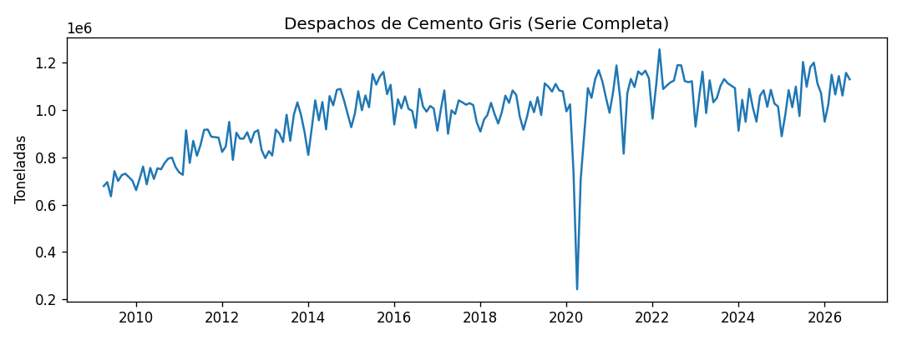
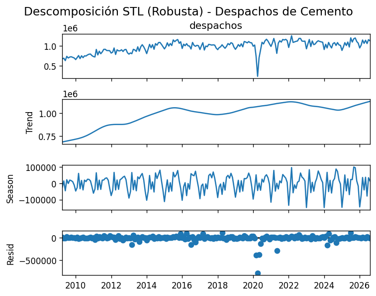
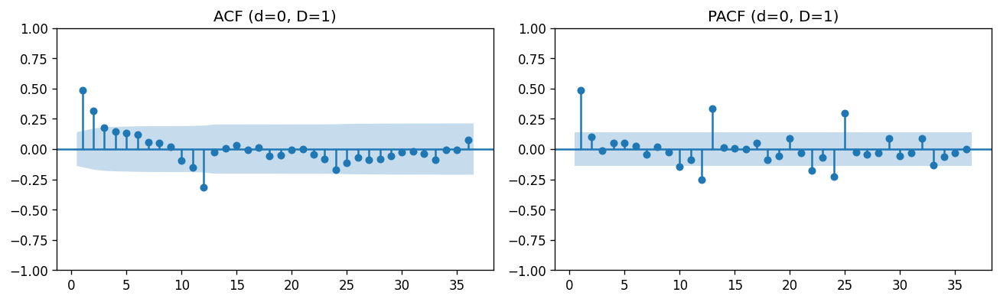
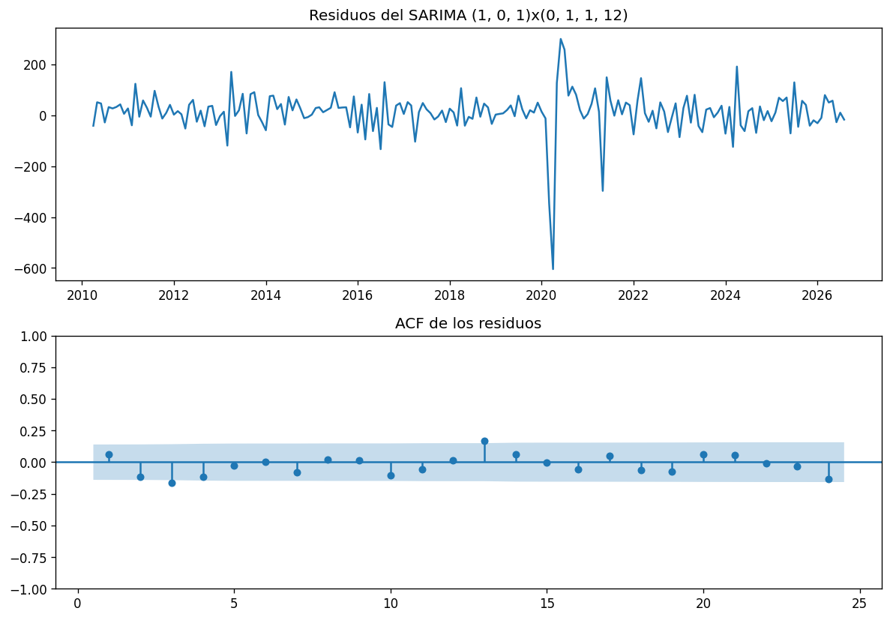

# Informe Miniproyecto 1: Modelamiento y Pronóstico de Despachos Nacionales de Cemento Gris en Colombia

## 1. La Serie Temporal

### 1.1. Contexto y Ficha Técnica
El presente estudio analiza la evolución mensual de los despachos nacionales de cemento gris en Colombia, una variable macroeconómica fundamental y un indicador adelantado del sector de la construcción y la infraestructura nacional. Los datos se obtuvieron del Departamento Administrativo Nacional de Estadística (DANE), correspondientes a la encuesta mensual de cemento gris (Anexo 2, columna *Total nacional*).

* **Frecuencia:** Mensual (`MS` - inicio de mes).
* **Periodo de observación:** Abril de 2009 a agosto de 2026.
* **Número de observaciones:** 209 meses ($N = 209$).
* **Valores faltantes (nulos):** 0.
* **Unidad de medida:** Toneladas métricas.

```
+-------------------------------------------------------------------------------+
| Ficha Técnica de la Serie Temporal                                           |
+-------------------+-----------------------------------------------------------+
| Indicador         | Despachos nacionales de cemento gris                      |
| Fuente            | DANE (Anexo 2 - Total Nacional)                           |
| Cobertura         | Colombia                                                  |
| Periodo           | 2009-04 a 2026-08 (209 observaciones)                     |
| Mínimo Registrado | 242,414.00 ton (Abril de 2020)                            |
| Máximo Registrado | 1,262,490.58 ton (Octubre de 2022)                        |
+-------------------+-----------------------------------------------------------+
```



### 1.2. Tratamiento de Datos Atípicos y Decisiones Metodológicas
Al examinar la serie histórica en la Figura 1, se aprecia una trayectoria predominantemente ascendente entre 2009 y 2015, seguida de una fase de estabilización estructural alrededor del millón de toneladas mensuales. Sin embargo, el rasgo gráfico más sobresaliente es la severa caída registrada en **abril de 2020**, mes en el cual los despachos descendieron a **242,414.00 toneladas**, el valor mínimo absoluto del histórico.

Desde el punto de vista econométrico, este evento coincide temporalmente con la implementación de las medidas sanitarias de confinamiento estricto y la paralización de actividades operativas e industriales derivadas de la pandemia de COVID-19 en Colombia. 

**Decisión metodológica adoptada:**
Se decidió **conservar la serie histórica completa sin realizar recortes ni imputaciones de valores atípicos**. Esta determinación responde a tres argumentos metodológicos:
1. **Integridad del horizonte de evaluación:** El esquema de *backtesting* con origen móvil evalúa los últimos 24 meses de la serie (2024 a 2026). Las observaciones de 2020 actúan como antecedente histórico en la ventana de entrenamiento inicial y no contaminan directamente la evaluación fuera de muestra.
2. **Preservación de la estructura estacional:** Recortar o alterar la serie introduciría discontinuidades artificiales que afectarían los algoritmos de diferenciación estacional ($D=1$).
3. **Escalamiento computacional:** Para garantizar la estabilidad numérica en los algoritmos de optimización de estimación por Máxima Verosimilitud (MLE) de los modelos de la familia ARIMA/SARIMAX, se aplicó un factor de conversión $\text{ESCALA} = 1000.0$. De esta manera, el modelo ajusta las variables expresadas en *miles de toneladas*, retornando la escala original a toneladas en la etapa de generación de pronósticos.

---

## 2. Descomposición STL

Para aislar las dinámicas subyacentes de la serie, se implementó una descomposición estacional y de tendencia mediante LOESS (**STL**, *Seasonal and Trend decomposition using Loess*) configurada con un periodo estacional $m = 12$ y estimación robusta (`robust=True`).



### 2.1. Propósito y Significado de la Configuración STL Robusta
La descomposición STL convencional basada en mínimos cuadrados es altamente sensible a choques aislados de gran magnitud. Al activar la opción `robust=True`, el algoritmo aplica un esquema iterativo de ponderación doble (*reweighted Least Squares*), reduciendo la influencia de observaciones anómalas en la estimación de las componentes de tendencia y estacionalidad. Esto previene que el colapso puntual de abril de 2020 distorsione el patrón estacional recurrente de la serie.

Es fundamental remarcar una distinción teórica: **la robustez del método STL es un procedimiento no paramétrico exclusivo de la etapa exploratoria y no se transmite de manera implícita a los modelos paramétricos posteriores (SARIMA/SARIMAX)**, los cuales continúan siendo sensibles a residuos extremos en el cálculo de su función de verosimilitud.

### 2.2. Lectura y Diagnóstico de Componentes
* **Tendencia:** Muestra una senda ascendente desde 688,597 toneladas en abril de 2009 hasta alcanzar los 1,127,929 toneladas en agosto de 2026, con fluctuaciones intermedias de desaceleración económica entre 2016 y 2019.
* **Estacionalidad:** Presenta un comportamiento anual coherente y determinístico a lo largo del tiempo:
  * **Mes con mayor estacionalidad positiva:** Octubre, con un aporte promedio de $+57,262.95$ toneladas por encima de la tendencia general, asociado históricamente al pico de ejecución de obras civiles e infraestructura previéndose al cierre de año fiscal.
  * **Mes con menor estacionalidad:** Enero, con una desviación de $-105,773.50$ toneladas, reflejando el receso vacacional de la construcción y la desaceleración operativa de principio de año.
* **Componente Residual:** El residuo de mayor magnitud se ubica en **abril de 2020**, registrando un valor de **$-784,910.54$ toneladas**, lo que confirma que la caída de dicho mes no obedece a un comportamiento estacional ni a un cambio de tendencia secular, sino a un choque exógeno extraordinario.

---

## 3. Estacionariedad e Identificación

El modelamiento de la familia Box-Jenkins exige que la serie temporal sea estacionaria en media y varianza, es decir, que sus propiedades estadísticas permanezcan constantes a través del tiempo.

### 3.1. Evaluación de Estacionariedad: Prueba ADF
Se aplicó la prueba de Raíz Unitaria de Dickey-Fuller Aumentada (**ADF**) a cuatro transformaciones de la serie. La hipótesis nula ($\text{H}_0$) de la prueba plantea que la serie posee una raíz unitaria (es no estacionaria), frente a la hipótesis alternativa ($\text{H}_1$) de estacionariedad. Para la serie original sin diferenciar se utilizó un modelo con tendencia y constante (`ct`), mientras que para las series diferenciadas se especificó un modelo únicamente con constante (`c`).

| Serie Evaluada | Especificación $d, D$ | Tipo de Regresión | Estadístico ADF | Valor $p$ | Rezagos Usados | Conclusión ($\alpha = 0.05$) |
| :--- | :---: | :---: | :---: | :---: | :---: | :--- |
| **Original** | $d=0, D=0$ | `ct` | $-2.366238$ | $0.397715$ | 13 | No se rechaza $\text{H}_0$ (No estacionaria) |
| **Diferencia Regular** | $d=1, D=0$ | `c` | $-9.142118$ | $2.8309 \times 10^{-15}$ | 12 | Se rechaza $\text{H}_0$ (Estacionaria) |
| **Diferencia Estacional** | $d=0, D=1$ | `c` | $-3.474875$ | $0.008657$ | 11 | Se rechaza $\text{H}_0$ (Estacionaria) |
| **Diferencia Reg. y Est.** | $d=1, D=1$ | `c` | $-6.429878$ | $1.7078 \times 10^{-08}$ | 13 | Se rechaza $\text{H}_0$ (Estacionaria) |

**Criterio de Selección:**
El guion automatizado aplica un principio de **parsimonia**: entre las versiones estacionarias (valor $p < 0.05$), prioriza aquella que requiera el menor número total de transformaciones de diferenciación ($d + D$). Tanto $(d=1, D=0)$ como $(d=0, D=1)$ emplean una única diferencia. El algoritmo selecciona **$d=0, D=1$** (diferenciación estacional simple), dado su valor $p = 0.0087$. Esta decisión conserva la dinámica de corto plazo mientras elimina la no estacionariedad inducida por el ciclo anual.

### 3.2. Análisis de Correlación: ACF y PACF
Una vez transformada la serie mediante $d=0$ y $D=1$, se calcularon la Función de Autocorrelación ($ACF$) y la Función de Autocorrelación Parcial ($PACF$) sobre 36 rezagos para identificar los órdenes de los procesos autorregresivos ($p, P$) y de medias móviles ($q, Q$).



* **Rezagos significativos en ACF (identificación de $q, Q$):** Rezagos 1, 2 y 12 sobresalen fuera de la banda de confianza teórica del 95%. La significancia en el rezago 12 corrobora la necesidad de una estructura de medias móviles estacional ($Q \ge 1$).
* **Rezagos significativos en PACF (identificación de $p, P$):** Rezagos 1, 10, 12, 13, 22, 24 y 25 cruzan los límites de confianza. Los picos en 1 y en múltiplos estacionales (12, 24) sugieren la presencia de términos autorregresivos tanto no estacionales ($p \ge 1$) como estacionales ($P \ge 1$).

---

## 4. Modelos Clásicos y Diagnóstico

### 4.1. Selección del Modelo SARIMA por Criterio de Información
Se realizó una búsqueda en rejilla (*grid search*) sobre los parámetros $(p, q, P, Q) \in \{0, 1\}^4$ bajo el esquema de diferenciación fija $(d=0, D=1, m=12)$. Los modelos se ordenaron según el Criterio de Información de Akaike (AIC), el cual penaliza la complejidad del modelo (número de parámetros) en relación con su bondad de ajuste.

| Orden $(p, d, q)$ | Orden Estacional $(P, D, Q)_{12}$ | AIC |
| :---: | :---: | :---: |
| **$(1, 0, 1)$** | **$(0, 1, 1)_{12}$** | **2316.4904** |
| $(1, 0, 1)$ | $(1, 1, 1)_{12}$ | 2318.4332 |
| $(1, 0, 0)$ | $(0, 1, 1)_{12}$ | 2326.9368 |
| $(1, 0, 0)$ | $(1, 1, 1)_{12}$ | 2328.5297 |
| $(1, 0, 1)$ | $(1, 1, 0)_{12}$ | 2362.1248 |

El modelo óptimo seleccionado según AIC es el **SARIMA $(1, 0, 1) \times (0, 1, 1)_{12}$**.

**Interpretación de la estructura del modelo:**
$$\Phi_P(B^{12}) \phi_p(B) (1 - B^{12})^D (1 - B)^d Y_t = \Theta_Q(B^{12}) \theta_q(B) \epsilon_t$$
Sustituyendo los órdenes específicos del modelo $(1, 0, 1) \times (0, 1, 1)_{12}$:
$$(1 - \phi_1 B) (1 - B^{12}) Y_t = (1 + \theta_1 B) (1 + \Theta_1 B^{12}) \epsilon_t$$
Donde:
* $p=1$: Un término autorregresivo ordinario que capta la inercia del mes inmediatamente anterior.
* $d=0$: Sin diferenciación regular.
* $q=1$: Un término de media móvil ordinario que amortigua el choque aleatorio del mes anterior.
* $P=0$: Sin término autorregresivo estacional.
* $D=1$: Una diferencia estacional de 12 meses.
* $Q=1$: Un término de media móvil estacional para ajustar los errores ocurridos en el mismo mes del año previo.

*Nota metodológica:* Un menor valor de AIC garantiza una representación óptima en términos de la pérdida de información del modelo dentro de la muestra, pero no constituye una garantía automática de superioridad en el desempeño predictivo fuera de muestra, razón por la cual es indispensable la validación por *backtesting*.

### 4.2. Diagnóstico de Residuos
Para verificar si los residuos del modelo seleccionado se comportan como ruido blanco (descorrelacionados), se aplicó la prueba de hipótesis de Ljung-Box sobre los residuos del modelo ajustado.

$$\text{H}_0: \text{Los residuos están independientemente distribuidos (ruido blanco)}$$
$$\text{H}_1: \text{Los residuos exhiben autocorrelación serial}$$

| Rezago ($k$) | Estadístico Ljung-Box ($Q$) | Valor $p$ | Conclusión ($\alpha = 0.05$) |
| :---: | :---: | :---: | :---: |
| 3 | 8.7336 | 0.0331 | Se rechaza $\text{H}_0$ (Presencia de autocorrelación) |
| 12 | 16.0085 | 0.1908 | No se rechaza $\text{H}_0$ (Ausencia de autocorrelación) |
| 24 | 31.9515 | 0.1282 | No se rechaza $\text{H}_0$ (Ausencia de autocorrelación) |



La evaluación formal de los residuos mediante la prueba de Ljung-Box arroja un estadístico de $8.7336$ con un valor $p = 0.0331$ en el rezago 3. Al ser este valor inferior al nivel de significancia ($\alpha = 0.05$), se rechaza la hipótesis nula de ruido blanco en dicho corte, evidenciando que aún persiste una autocorrelación serial remanente estadísticamente significativa en ese rezago de corto plazo. No obstante, al evaluar los rezagos estacionales 12 y 24, los valores $p$ ascienden a $0.1908$ (estadístico de $16.0085$) y $0.1282$ (estadístico de $31.9515$) respectivamente; al superar el umbral de $0.05$, no se rechaza la hipótesis nula a nivel global, confirmando que la dinámica estacional anual ha sido capturada en su totalidad.

Pese a la significancia detectada en el rezago 3, el análisis visual de la ACF muestra que dicho bastón sobrepasa de forma apenas marginal la franja azul del intervalo de confianza del 95%. Por consiguiente, y en estricto apego al principio de parsimonia, el cual restringe la búsqueda a órdenes bajos dentro del conjunto $[0, 1, 2]$, se decidió mantener el mismo modelo candidato SARIMA $(1, 0, 1) \times (0, 1, 1)_{12}$ con los órdenes propuestos. Forzar la inclusión de parámetros de orden superior ($p=3$ o $q=3$) solo para absorber este rezago puntual incrementaría la complejidad del modelo y el riesgo de sobreajuste sin aportar una mejora sustancial en el pronóstico.

Finalmente, el examen visual de la Figura 4 revela que en abril de 2020 se presenta un residuo negativo de gran magnitud que supera los $-600$ en la escala de miles de toneladas. Esto pone de manifiesto que, si bien el modelo ha capturado adecuadamente la estructura temporal principal, los residuos presentan heterocedasticidad (varianza no constante) y no normalidad estricta, condicionadas directamente por el choque puntual de la pandemia.

### 4.3. Incorporación de Variables Exógenas (SARIMAX)
Con el fin de mejorar la capacidad explicativa del modelo, se construyó un modelo **SARIMAX $(1, 0, 1) \times (0, 1, 1)_{12}$** incorporando como variable exógena el **número de días festivos en Colombia por mes**, extraídos mediante la librería `holidays`.

* **Prevención de fuga de información (*Data Leakage*):** Dado que el calendario de festivos nacionales es determinístico y completamente conocido de antemano, esta variable puede incluirse legítimamente en el horizonte de pronóstico de $h=12$ meses sin violar las condiciones de causalidad del *backtest*. 
* **Advertencia de convergencia:** Durante la fase de estimación de los modelos ARIMA y SARIMAX, la librería `statsmodels` puede generar advertencias del optimizador numérico (*Maximum Likelihood optimization failed to converge*). Esto sugiere que la inclusión de covariables o estructuras complejas en presencia de atípicos extremos genera regiones planas en la superficie de la función de verosimilitud, afectando la estabilidad estricta de la matriz de covarianza de los parámetros.

---

## 5. Comparación de Modelos y Evaluación de Métricas

### 5.1. Esquema de Evaluación (*Backtesting*)
La evaluación fuera de muestra se ejecutó mediante un esquema de origen móvil estricto (*rolling origin backtest*) configurado en `comun.py`:
* **Horizonte de evaluación:** Últimos 24 meses de la serie ($n_{\text{prueba}} = 24$).
* **Horizonte de pronóstico:** $h = 12$ meses hacia el futuro en cada origen.
* **Proceso:** El modelo recalibra sus parámetros usando exclusivamente la información acumulada hasta el origen temporal $t$, generando pronósticos para $t+1, \dots, t+12$.

### 5.2. Definición de Métricas de Error
Se evaluaron tres métricas continuas de error:
1. **RMSE (Root Mean Squared Error):** 
   $$\text{RMSE} = \sqrt{\frac{1}{h} \sum_{k=1}^h (y_{t+k} - \hat{y}_{t+k})^2}$$
   Mide la magnitud media de los errores ponderando cuadráticamente los desvíos, por lo que es especialmente sensible a errores grandes.
2. **MAE (Mean Absolute Error):** 
   $$\text{MAE} = \frac{1}{h} \sum_{k=1}^h |y_{t+k} - \hat{y}_{t+k}|$$
   Representa el error medio absoluto en las mismas unidades de la serie (toneladas).
3. **MAPE (Mean Absolute Percentage Error):** 
   $$\text{MAPE} = \frac{100\%}{h} \sum_{k=1}^h \left| \frac{y_{t+k} - \hat{y}_{t+k}}{y_{t+k}} \right|$$
   Expresa el error en términos porcentuales relativos al valor real observado.

En todas las métricas, **un menor valor indica una mayor precisión predictiva**.

### 5.3. Tabla Consolidada de Resultados
La siguiente tabla presenta el desempeño promedio obtenido por cada modelo a lo largo de las ventanas del *backtest*, consolidado en `resultados/metricas.csv`:

| Posición | Modelo | Decisión sobre Datos | RMSE (ton) | MAE (ton) | MAPE (%) |
| :---: | :--- | :--- | :---: | :---: | :---: |
| **1** | **SARIMAX (1,0,1)(0,1,1)12 + exógenas** | Sin recortes (serie completa) | **85,051.40** | **72,344.36** | **6.54%** |
| 2 | Ingenuo Estacional | Sin recortes (serie completa) | 89,786.81 | 78,144.62 | 7.07% |
| 3 | SARIMA (1,0,1)(0,1,1)12 | Sin recortes (serie completa) | 90,620.14 | 76,555.65 | 6.85% |
| 4 | Ingenuo | Sin recortes (serie completa) | 111,709.71 | 95,200.12 | 8.72% |

### 5.4. Análisis Crítico de los Resultados Predictivos
1. **Dominancia del modelo SARIMAX:** El modelo **SARIMAX con variable exógena de festivos** logró el mejor desempeño global en el *backtest*, reduciendo el RMSE a $85,051.40$ toneladas y el MAPE a $6.54\%$. La inclusión del número de días hábiles/festivos captura eficazmente las fluctuaciones mensuales en la intensidad de los despachos industriales.
2. **Anomalía del Modelo Ingenuo Estacional vs. SARIMA:** Un hallazgo relevante es que el **Ingenuo Estacional** (RMSE $89,786.81$) superó al **SARIMA puramente estocástico** (RMSE $90,620.14$). Este comportamiento se explica por la presencia del choque atípico de 2020 en la serie de entrenamiento: mientras que el modelo SARIMA intenta ajustar coeficientes AR y MA sobre residuos contaminados por la pandemia (lo que altera las ponderaciones estocásticas), el modelo ingenuo estacional replica directamente la estructura estacional determinística previa sin amplificar la varianza por estimación de parámetros.
3. **Ganancia del Mejor Modelo frente a la Línea Base:**
   Al comparar el modelo ganador (**SARIMAX**) frente a la mejor línea base (*Ingenuo Estacional*):
   * **Reducción del RMSE:** Reducción de $4,735.41$ toneladas (mejora del **$5.27\%$**).
   * **Reducción del MAE:** Reducción de $5,800.26$ toneladas (mejora del **$7.42\%$**).
   * **Reducción del MAPE:** Disminución de $0.53$ puntos porcentuales (mejora relativa del **$7.50\%$**).

---

## 6. Conclusiones

1. **Integridad de los Datos y Robustez:** La preservación de la serie histórica completa permitió un modelamiento sin sesgos de manipulación. El escalamiento por $1000.0$ garantizó la estabilidad numérica requerida para la optimización econométrica.
2. **Componentes y Estacionariedad:** La serie exhibe una marcada estacionalidad con picos de actividad en octubre y valles en enero. La prueba ADF confirmó que una diferencia estacional ($D=1$) es suficiente para alcanzar la estacionariedad por parsimonia.
3. **Poder Explicativo de las Variables Exógenas:** La incorporación de los días festivos en el modelo **SARIMAX** proporcionó la ganancia marginal necesaria para superar tanto al benchmark estacional como al modelo SARIMA clásico, demostrando la importancia de los factores de calendario operativo en el sector industrial de la construcción.
4. **Desafío para el Miniproyecto 2:** El benchmark cuantitativo a superar en la siguiente etapa por modelos de Aprendizaje Automático (ML) o Inteligencia Artificial queda establecido en un **RMSE de 85,051.40 toneladas** (o **MAPE de 6.54%**).

---

## 7. Referencias y Fuentes de Datos

* **Fuente de Datos:** Departamento Administrativo Nacional de Estadística (DANE). *Encuesta Mensual de Cemento Gris (EMCG)*. Anexo 2: Despachos totales según departamento de destino. Bogotá, Colombia.
* **Librerías de Computación Científica:** 
  * `statsmodels.tsa.statespace.sarimax.SARIMAX` para la estimación de modelos econométricos.
  * `holidays` para la generación del calendario de festivos oficiales de Colombia.
  * `scikit-learn` / `numpy` (v1.26.4) para el cálculo de métricas de desempeño.
